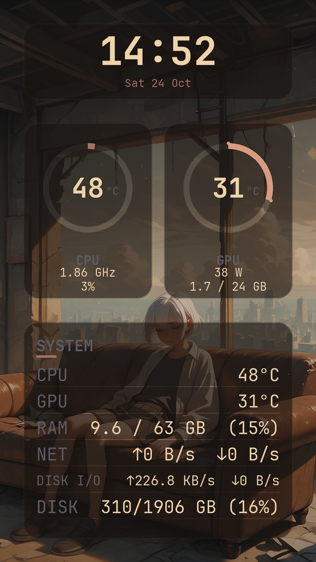

# omAIOpanel

**omAIOpanel** renders the **current Omarchy theme** (palette, wallpaper, font) plus **live
system sensors** onto a Thermalright AIO LCD screen (GrandVision 360, USB `87ad:70db`),
and ships with a **GTK4 visual layout editor**.



```text
Omarchy theme ──┐
                ├─> Pillow render ─> direct USB (bulk LCD protocol) ─> AIO panel
psutil / NVML ──┘
```

## Features

- **Theme-following**: reads `~/.local/state/omarchy/current/theme/` — palette
  (`colors.toml`), wallpaper, font (`fc-match`). Change your theme or wallpaper →
  the panel re-renders automatically.
- **Live info over the background**: clock + weather, CPU/GPU ring gauges
  (load arc + temperature + sub-metrics), RAM / network / disk / uptime stats
  card, audio visualizer — all theme-colored glass cards.
- **Direct USB** — no TRCC at runtime. Implements the GrandVision bulk-LCD
  protocol directly via `pyusb` (handshake, JPEG frames, 150 ms keepalive so the
  panel never falls back to its boot logo).
- **GTK4 editor** — visually build your layout: portrait/landscape per-orientation
  layouts, widget list with position spinners, per-widget settings (lines, colors,
  sensors), full-panel preset manager with live-rendered thumbnails, and the
  editor remembers your last preset + orientation across restarts.
- Efficient daemon: ~30 ms/frame render at 15 fps with slow sensors (temps,
  NVML, volumes) polled off the hot path.

## Requirements

- Linux (developed on **Omarchy / Arch**) + a Thermalright AIO with the
  GrandVision 360 LCD (USB ID `87ad:70db`)
- NVIDIA GPU for GPU stats (NVML); other vendors render fine but show no GPU data
- Python packages: `python-pillow python-numpy python-psutil python-pyusb`
  (plus `python-cairo`, `python-gobject` and GTK4/Adwaita for the editor —
  included in an Omarchy install)

## Install

```bash
git clone https://github.com/cowneko/omAIOpanel.git ~/Projects/omAIOpanel
cd ~/Projects/omAIOpanel
./install.sh
```

`install.sh` is idempotent and does everything:

1. installs the Python dependencies via pacman (asks for sudo),
2. installs the NVML binding for NVIDIA GPUs (via `uv`, no pip needed),
3. adds the udev rule giving your user USB access to the panel (`87ad:70db`),
4. installs + enables the `omAIOpanel` systemd **user** unit (the render daemon),
5. installs the `omAIOpanel editor` desktop launcher entry.

Plug the panel's USB into a motherboard USB 2.0 header port and you're done —
frames start pushing immediately.

## Usage

```bash
# daemon (installed & enabled by install.sh)
systemctl --user status omAIOpanel     # logs: journalctl --user -u omAIOpanel

# CLI, from the project dir
python -m aio preview                  # render current layout to ./aio-preview.png
python -m aio once --push              # push a single frame (stops the daemon first)
python -m aio restore                  # hand the panel back to its boot logo

# visual editor
python editor.py                       # or the "omAIOpanel editor" launcher entry
```

### Config

`~/.config/omAIOpanel/config.toml` — device, fps, wallpaper focus/scrim, fonts,
and the widget list. Edit the layout **in the editor** and press **Apply → panel**
(it writes this file; the daemon hot-reloads it). Hand-editing works too, then
`systemctl --user restart omAIOpanel`.

Full-panel presets (both orientations in one file) live in
`~/.config/omAIOpanel/presets/`.

## Editor

The editor follows a flat "omasettings" look and is synced to the current Omarchy
theme. Main menu offers: layout (portrait/landscape toggles), widgets (add from
templates or saved customs, edit positions, per-widget settings), panel presets
(save/update/load with rendered thumbnails), and global settings (panel style,
fonts, theme sync).

## Known limits

- Panel identity defaults to `87ad:70db` @ 540×960 portrait (edit `device`,
  `width`, `height` in the config for other panels).
- GPU stats need an NVIDIA GPU (NVML). AMD/Intel would need another sensor backend.
- The wire protocol was documented from TRCC (`thermalright-trcc`'s
  `bulk_lcd.py`) — many thanks to that project.
